# RailGuard — FFT & DSP-Based Railway Track Vibration Analysis and Anomaly Detection

[](https://www.python.org/)
[](#3-digital-signal-processing--fft-methodology)
[-FF6F00)](https://huggingface.co/datasets/saluslab/Rail-VIVID)
[](#9-synthetic-dsp--fft-unit-test-suite)
[](#8-interactive-streamlit-dashboard--outputs)

**RailGuard** is an interpretable Digital Signal Processing (DSP) and Fast Fourier Transform (FFT) inspection pipeline for onboard railway vibration monitoring. Built on the **Rail-VIVID** dataset ($f_s = 2000\text{ Hz}$, 6 triaxial/multi-point accelerometer channels + GPS), RailGuard transforms high-rate time-domain acceleration streams into calibrated one-sided amplitude spectra, Power Spectral Densities (Welch & Periodogram), Short-Time Fourier Transform (STFT) spectrograms, and physically grounded spectral features to flag impulsive track defects (rail joints, squats, wheel flats, and corrugation) in real time.

> [!IMPORTANT]
> **Scope & Design Philosophy:** Because the public Rail-VIVID dataset contains normal operational runs across varying speeds ($20\text{--}27.5\text{ km/h}$) and directions (`AtoB`, `BtoA`) without ground-truth defect timestamps, RailGuard is engineered as an **unsupervised baseline deviation detector** (`NORMAL-LIKE` vs. `REVIEW RECOMMENDED` vs. `HIGH DEVIATION`) rather than an overclaimed black-box fault classifier. Every step—from DC detrending and periodic Hann windowing to coherent-gain correction, Parseval energy conservation, and marginal Mahalanobis scoring—is mathematically transparent and verified against analytical synthetic benchmarks.

---

## Table of Contents

1. [System Architecture & End-to-End DSP Pipeline](#1-system-architecture--end-to-end-dsp-pipeline)
2. [Dataset & Hardware Anti-Aliasing Characterization](#2-dataset--hardware-anti-aliasing-characterization)
3. [Digital Signal Processing & FFT Methodology](#3-digital-signal-processing--fft-methodology)
   - [3.1 Segmentation & Time-Frequency Resolution Trade-Off](#31-segmentation--time-frequency-resolution-trade-off)
   - [3.2 Pre-Processing: DC Offset & Drift Removal](#32-pre-processing-dc-offset--drift-removal)
   - [3.3 Windowing & Spectral Leakage Suppression](#33-windowing--spectral-leakage-suppression)
   - [3.4 One-Sided Real FFT (`rfft`) & Coherent-Gain Calibration](#34-one-sided-real-fft-rfft--coherent-gain-calibration)
   - [3.5 Power Spectral Density: Periodogram vs. Welch's Method](#35-power-spectral-density-periodogram-vs-welchs-method)
   - [3.6 Parseval's Theorem & Energy Conservation](#36-parsevals-theorem--energy-conservation)
   - [3.7 Short-Time Fourier Transform (STFT) Spectrograms](#37-short-time-fourier-transform-stft-spectrograms)
4. [Synthetic DSP Validation Proofs](#4-synthetic-dsp-validation-proofs)
5. [Real-Data Spectral Analysis (`Rail-VIVID`)](#5-real-data-spectral-analysis-rail-vivid)
6. [Spectral Feature Extraction & Anomaly Scoring](#6-spectral-feature-extraction--anomaly-scoring)
7. [Empirical Evaluation & Semi-Synthetic Impact Detection](#7-empirical-evaluation--semi-synthetic-impact-detection)
8. [Interactive Streamlit Dashboard & Outputs](#8-interactive-streamlit-dashboard--outputs)
9. [Synthetic DSP & FFT Unit Test Suite](#9-synthetic-dsp--fft-unit-test-suite)
10. [Repository Structure & Quickstart](#10-repository-structure--quickstart)

---

## 1. System Architecture & End-to-End DSP Pipeline

RailGuard processes continuous $2000\text{ Hz}$ multi-channel acceleration streams through a strictly modular six-stage DSP and statistical pipeline:

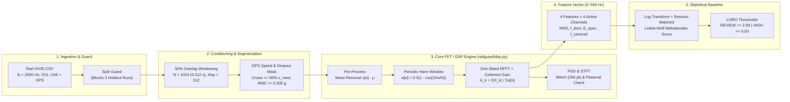

### Summary of Locked DSP & Pipeline Parameters

| Parameter | Symbol / Code | Value | Physical & DSP Justification |
| :--- | :--- | :--- | :--- |
| **Sampling Rate** | $f_s$ (`FS`) | $2000.0\text{ Hz}$ | Median $\Delta t = 0.500000\text{ ms}$; Nyquist frequency $f_{\text{Nyq}} = f_s/2 = 1000\text{ Hz}$ |
| **Hardware Passband** | $f_{\max}$ (`FMAX`) | $500.0\text{ Hz}$ | Onboard 500 Hz Butterworth low-pass anti-aliasing filter ($\le 0.017\%$ power $>500\text{ Hz}$) |
| **Segment Length** | $N$ (`SEG_LEN`) | $1024\text{ samples}$ | $T = 0.512\text{ s}$ ($\approx 2.8\text{--}5.1\text{ m}$ of track at $20\text{--}27.5\text{ km/h}$), exact power of 2 for radix-2 FFT |
| **Segment Hop** | $H$ (`HOP`) | $512\text{ samples}$ | $50\%$ overlap ($0.256\text{ s}$ step); satisfies **COLA** (Constant Overlap-Add) with Hann window |
| **Bin Spacing** | $\Delta f = f_s / N$ | $1.953125\text{ Hz}$ | Resolves harmonic combs $\ge 7.81\text{ Hz}$ apart (Hann null-to-null main-lobe width $4\Delta f$) |
| **Default Window** | `hann` (`fftbins=True`) | Periodic Hann | $-31.5\text{ dB}$ peak sidelobe, $-18\text{ dB/oct}$ roll-off; prevents $<50\text{ Hz}$ energy from swamping $200\text{--}500\text{ Hz}$ |
| **Active Score Channels** | `SCORE_CHANNELS` | `[1, 2, 3, 4]` | Ch5 & Ch6 have $\sim 10\times$ lower RMS ($\approx 0.03\text{ g}$) and $100\%$ power $<50\text{ Hz}$ |
| **Dropout Threshold** | `DEAD_RMS` | $0.005\text{ g}$ | Masks intermittent hardware sensor dropouts on Ch1/Ch3/Ch4 ($\approx 3\times 10^{-4}\text{ g}$ floor) |

---

## 2. Dataset & Hardware Anti-Aliasing Characterization

RailGuard operates on the **Rail-VIVID** dataset (`saluslab/Rail-VIVID`, DOI: `10.57967/hf/8411`), comprising 20 operational runs across two directions (`AtoB` and `BtoA`), three target speed tiers ($20$, $22.5$, $25$, and $27.5\text{ km/h}$), and two recording sessions (`2025-04-11` and `2025-04-18`).

### Hardware 500 Hz Butterworth Low-Pass Filter Discovery

While the nominal sampling frequency is $f_s = 2000\text{ Hz}$ ($f_{\text{Nyq}} = 1000\text{ Hz}$), whole-run Welch Power Spectral Density inspection across all channels reveals a sharp **8th-order-like roll-off beginning at exactly $500\text{ Hz}$**, consistent with the onboard hardware Butterworth anti-aliasing filter:

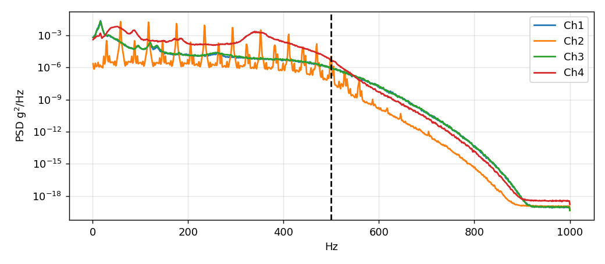

* **Quantitative Stop-Band Attenuation (`BtoA_27.5_2`):**
  * **Channel 1:** $92.0\%$ power in $0\text{--}50\text{ Hz}$, $6.0\%$ in $50\text{--}200\text{ Hz}$, $2.0\%$ in $200\text{--}500\text{ Hz}$, and **$0.017\%$ in $500\text{--}1000\text{ Hz}$** (PSD drops from $-32.1\text{ dB}$ at $0\text{--}100\text{ Hz}$ to $-109.1\text{ dB}$ at $800\text{--}1000\text{ Hz}$).
  * **Channel 2:** $0.6\%$ power in $0\text{--}50\text{ Hz}$, $67.9\%$ in $50\text{--}200\text{ Hz}$, $31.5\%$ in $200\text{--}500\text{ Hz}$, and **$0.000\%$ in $500\text{--}1000\text{ Hz}$** (PSD drops from $-24.1\text{ dB}$ in $100\text{--}300\text{ Hz}$ to **$-146.1\text{ dB re }\text{g}^2/\text{Hz}$** above $800\text{ Hz}$).
* **Design Consequence:** All spectral features (`dom_freq`, `spec_energy`, `spec_centroid`) are integrated strictly over the physical passband **$f \in (0, 500]\text{ Hz}$** (`FMAX = 500.0`) so that stop-band quantization noise never dilutes feature sensitivity, while diagnostic FFT and spectrogram views display the full $0\text{--}1000\text{ Hz}$ Nyquist range to visually verify anti-aliasing integrity.

### Channel-by-Channel Spectral Role

| Channel | Typical Mean ($\text{g}$) | Cruise Std ($\text{g}$) | Power $<50\text{ Hz}$ | Power $50\text{--}200\text{ Hz}$ | Power $200\text{--}500\text{ Hz}$ | Primary Dominant Peak | Role in RailGuard |
| :---: | :---: | :---: | :---: | :---: | :---: | :---: | :--- |
| **Ch1** | $-0.004$ | $0.459$ | $92.0\%$ | $6.0\%$ | $2.0\%$ | $16.6\text{ Hz}$ | Low-freq car-body/bogie bounce & suspension dynamics |
| **Ch2** | $-0.004$ | $0.892$ | $0.6\%$ | $67.9\%$ | $31.5\%$ | $58.6\text{ Hz}$ | **Primary broadband axle-box/rail channel (0% dropout)** |
| **Ch3** | $+0.931$ | $0.440$ | $90.9\%$ | $6.6\%$ | $2.5\%$ | $16.6\text{ Hz}$ | Vertical axis ($+1\text{ g}$ static gravity bias removed in DSP) |
| **Ch4** | $+0.025$ | $0.431$ | $11.5\%$ | $43.9\%$ | $44.6\%$ | $50.8\text{ Hz}$ | High-frequency wheel-rail roughness & impact band |
| **Ch5** | $-0.044$ | $0.032$ | $100.0\%$ | $0.0\%$ | $0.0\%$ | $2.0\text{ Hz}$ | Low-gain auxiliary channel (extracted, excluded from score) |
| **Ch6** | $+0.030$ | $0.030$ | $100.0\%$ | $0.0\%$ | $0.0\%$ | $2.0\text{ Hz}$ | Low-gain auxiliary channel (extracted, excluded from score) |

---

## 3. Digital Signal Processing & FFT Methodology

All core signal processing routines are implemented from first principles in [`railguard/dsp.py`](railguard/dsp.py) using `numpy.fft.rfft` and `scipy.signal`.

### 3.1 Segmentation & Time-Frequency Resolution Trade-Off

Continuous non-stationary vibration signals $x[n]$ must be partitioned into quasi-stationary frames of length $N$ before Fourier analysis. By the **Gabor-Heisenberg uncertainty principle**, frequency resolution $\Delta f$ and temporal localization $T$ are inversely coupled:

$$\Delta f = \frac{f_s}{N}, \qquad T = \frac{N}{f_s} \implies \Delta f \cdot T = 1$$

| Candidate $N$ | Frame Duration $T$ | Track Footprint (@ $27.5\text{ km/h}$) | Bin Spacing $\Delta f$ | Hann Main-Lobe Width ($4\Delta f$) | Engineering Trade-Off |
| :---: | :---: | :---: | :---: | :---: | :--- |
| $256$ | $0.128\text{ s}$ | $0.98\text{ m}$ | $7.8125\text{ Hz}$ | $31.25\text{ Hz}$ | **Too coarse spectrally:** merges $16.6\text{ Hz}$ bogie bounce with $50\text{--}60\text{ Hz}$ wheel-rail fundamentals |
| $512$ | $0.256\text{ s}$ | $1.96\text{ m}$ | $3.90625\text{ Hz}$ | $15.63\text{ Hz}$ | Borderline resolution for closely spaced harmonic sidebands |
| **$1024$ (Selected)** | **$0.512\text{ s}$** | **$3.91\text{ m}$** | **$1.953125\text{ Hz}$** | **$7.81\text{ Hz}$** | **Optimal balance:** cleanly resolves $58.6\text{ Hz}$ harmonic comb while localizing defects to $\sim 3\text{--}5\text{ m}$ |
| $2048$ | $1.024\text{ s}$ | $7.82\text{ m}$ | $0.9765625\text{ Hz}$ | $3.91\text{ Hz}$ | **Too long temporally:** dilutes a $50\text{--}100\text{ ms}$ rail-joint impact over $>1\text{ s}$ ($10\times$ energy dilution) |

With **50% overlap** ($H = 512$ samples, $\Delta t_{\text{step}} = 0.256\text{ s}$), the periodic Hann window satisfies the **Constant Overlap-Add (COLA)** condition:

$$w[n] + w\left[n + \frac{N}{2}\right] = \frac{1}{2}\left(1 - \cos\frac{2\pi n}{N}\right) + \frac{1}{2}\left(1 - \cos\left(\frac{2\pi n}{N} + \pi\right)\right) = 1 \quad \forall n$$

ensuring that transient impacts occurring near the boundary of segment $m$ lie at the unity-gain center of segment $m+1$.

---

### 3.2 Pre-Processing: DC Offset & Drift Removal

In [`dsp.preprocess`](railguard/dsp.py), every $N$-sample segment undergoes mean removal (`detrend="constant"`) prior to windowing:

$$\tilde{x}[n] = x[n] - \frac{1}{N}\sum_{m=0}^{N-1} x[m]$$

**Why detrending before windowing is mandatory:**
Multiplying a signal with a static DC bias $C$ (such as Channel 3's $+0.931\text{ g}$ vertical gravity component) by a non-rectangular window $w[n]$ modulates the DC term into the window's spectrum $C \cdot W(f)$. Because the Hann main lobe extends across $k \in \{0, 1, 2\}$ ($0\text{--}3.91\text{ Hz}$), failing to subtract the mean prior to windowing injects false energy into bin $k=1$ ($1.95\text{ Hz}$), corrupting both `dom_freq` and `spec_energy`.

---

### 3.3 Windowing & Spectral Leakage Suppression

Finite-length observation of a discrete signal is equivalent to multiplication by a window function $w[n]$ in the time domain, which corresponds to circular convolution of the true spectrum $X(e^{j\omega})$ with the window transform $W(e^{j\omega})$ in the frequency domain:

$$Y[k] = \sum_{n=0}^{N-1} \tilde{x}[n]\, w[n]\, e^{-j 2\pi k n / N} = \frac{1}{2\pi} \left( \tilde{X} * W \right)\!\left(\frac{2\pi k}{N}\right)$$

Whenever a sinusoidal component has a frequency $f_0$ that is not an exact integer multiple of $\Delta f = f_s/N$ (non-integer cycles $M = f_0 N / f_s \notin \mathbb{Z}$), periodic extension across the frame boundary introduces a step discontinuity.

| Window Type | Equation $w[n]$ ($0 \le n < N$) | Coherent Gain $CG = \frac{1}{N}\sum w[n]$ | Equivalent Noise Bandwidth (ENBW) | Highest Sidelobe | Sidelobe Roll-Off Rate |
| :--- | :--- | :---: | :---: | :---: | :---: |
| **Rectangular (`rect`)** | $1$ | $1.00$ | $1.00\text{ bins}$ | $-13.3\text{ dB}$ | $-6\text{ dB / octave}$ |
| **Hamming (`hamming`)** | $0.54 - 0.46\cos(2\pi n / N)$ | $0.54$ | $1.36\text{ bins}$ | $-42.7\text{ dB}$ | $-6\text{ dB / octave}$ |
| **Hann (`hann`, Default)** | $0.50 - 0.50\cos(2\pi n / N)$ | $0.50$ | $1.50\text{ bins}$ | $-31.5\text{ dB}$ | **$-18\text{ dB / octave}$** |

> [!TIP]
> **Why Periodic Hann (`fftbins=True`) over Hamming for Railway Accelerometers:**
> Although Hamming has a slightly lower first sidelobe ($-42.7\text{ dB}$ vs. $-31.5\text{ dB}$), its endpoints do not reach zero ($w[0] = 0.08$), resulting in a slow $-6\text{ dB/octave}$ asymptotic decay. Hann tapers smoothly to zero in value and first derivative, giving a **$-18\text{ dB/octave}$ roll-off**. Because Ch1 and Ch3 concentrate $>90\%$ of their power below $50\text{ Hz}$, rapid far-out sidelobe decay is essential so low-frequency car-body bounce does not leak across $150\text{--}450\text{ Hz}$ and mask high-frequency rail-defect signatures.

---

### 3.4 One-Sided Real FFT (`rfft`) & Coherent-Gain Calibration

Because accelerometer measurements $y[n] \in \mathbb{R}$ are purely real, the Discrete Fourier Transform exhibits **conjugate symmetry**:

$$X[N - k] = X^*[k] \implies |X[N - k]| = |X[k]|$$

Negative-frequency bins ($N/2 < k < N$) are redundant mirror images. [`dsp.amplitude_spectrum`](railguard/dsp.py) computes the one-sided transform via `np.fft.rfft(y, n=nfft)`, returning $n_{\text{fft}}/2 + 1$ non-negative bins at frequencies:

$$f_k = \frac{k \cdot f_s}{n_{\text{fft}}}, \qquad k = 0, 1, \dots, \frac{n_{\text{fft}}}{2}$$

To recover the **true physical peak amplitude in $\text{g}$** of any sinusoid $A\sin(2\pi f_0 t)$, the raw DFT magnitudes $|X_k|$ must be normalized by the window's **coherent gain** $\sum_{n=0}^{N-1} w[n]$ and doubled for interior bins ($0 < k < n_{\text{fft}}/2$) to fold in the symmetric negative-frequency energy:

$$A_k = \begin{cases} \displaystyle \frac{|X_0|}{\sum_{n=0}^{N-1} w[n]}, & k = 0 \text{ (DC)} \\[12pt] \displaystyle \frac{2\,|X_k|}{\sum_{n=0}^{N-1} w[n]}, & 1 \le k < \frac{n_{\text{fft}}}{2} \text{ (Interior Positive Frequencies)} \\[12pt] \displaystyle \frac{|X_{n_{\text{fft}}/2}|}{\sum_{n=0}^{N-1} w[n]}, & k = \frac{n_{\text{fft}}}{2} \text{ (Nyquist, even } n_{\text{fft}}\text{)} \end{cases}$$

* **Critical Calibration Detail:** For a Hann window, $\sum_{n=0}^{N-1} w[n] = N/2$. Naive normalization by $2/N$ instead of $2/\sum w[n]$ underestimates every spectral peak by a factor of $0.5$ (**$-6.02\text{ dB}$ error**). Furthermore, when zero-padding ($n_{\text{fft}} > N$), the coherent sum $\sum_{n=0}^{N-1} w[n]$ is still taken strictly over the $N$ support samples—zero-padding appends no signal energy.
* **Decibel Conversion (`dsp.to_db`):** Amplitude spectra are converted to decibels relative to $1\text{ g}$ using the **20-log amplitude rule** with a $-240\text{ dB}$ numerical floor:
  $$A_{\text{dB}}(f_k) = 20 \log_{10}\!\left(\frac{\max(A_k,\, 10^{-12})}{1\text{ g}}\right)$$

---

### 3.5 Power Spectral Density: Periodogram vs. Welch's Method

For stochastic broadband vibrations (wheel-rail rolling roughness and aerodynamic/track noise), peak amplitude $A_k$ depends on $N$, whereas the **Power Spectral Density (PSD)** in $\text{g}^2/\text{Hz}$ is invariant to transform length and normalized by window **incoherent power gain** $S_2 = \sum_{n=0}^{N-1} w^2[n]$:

$$P_{xx}(f_k) = \frac{c_k\, |X_k|^2}{f_s \sum_{n=0}^{N-1} w^2[n]} \quad \left[\frac{\text{g}^2}{\text{Hz}}\right], \qquad c_k = \begin{cases} 1, & k = 0 \text{ or } k = n_{\text{fft}}/2 \\ 2, & 0 < k < n_{\text{fft}}/2 \end{cases}$$

1. **Single-Segment Windowed Periodogram (`dsp.periodogram_psd`):** High frequency resolution ($\Delta f = 1.953\text{ Hz}$ for $N=1024$), but statistically **inconsistent**—for Gaussian white noise, the standard deviation at every bin equals the mean ($\text{CV} = \sigma_P / \mu_P \approx 1.00$, $100\%$ estimator variance regardless of how large $N$ grows).
2. **Welch's Overlapped Averaged Periodogram (`dsp.welch_psd`):** Splits the record into $K$ overlapping sub-segments of length $L = 256$ ($\Delta f = 7.8125\text{ Hz}$) with $50\%$ overlap and averages their windowed periodograms:
   $$\hat{P}_{\text{Welch}}(f_k) = \frac{1}{K} \sum_{m=0}^{K-1} P_{xx}^{(m)}(f_k), \qquad \text{Var}\!\left[\hat{P}_{\text{Welch}}\right] \approx \frac{9}{8K}\,\text{Var}\!\left[P_{xx}\right]$$
   trading $4\times$ coarser bin spacing for an $\approx \sqrt{K}$ reduction in estimator standard deviation.

---

### 3.6 Parseval's Theorem & Energy Conservation

[`dsp.parseval_check`](railguard/dsp.py) verifies on every segment that total discrete-time energy after windowing equals total one-sided DFT energy to machine precision:

$$E_{\text{time}} = \sum_{n=0}^{N-1} |y[n]|^2 \equiv E_{\text{freq}} = \frac{1}{N} \sum_{k=0}^{N/2} c_k\, |Y[k]|^2, \qquad \frac{|E_{\text{time}} - E_{\text{freq}}|}{E_{\text{time}}} < 10^{-10}$$

To estimate true physical band energy in $\text{g}^2\cdot\text{s}$ across $f \in (0, 500]\text{ Hz}$ after windowing, RailGuard divides the windowed Parseval energy by the window's mean-square power $\frac{1}{N}\sum_{n=0}^{N-1} w^2[n] = \frac{3}{8} = 0.375$ (for Hann):

$$E_{\text{spec}}(0, 500\text{ Hz}] = \frac{1}{f_s} \sum_{k=1}^{k_{500}} \frac{c_k\, |X_k|^2}{n_{\text{fft}} \cdot \left(\frac{1}{N}\sum_{n=0}^{N-1} w^2[n]\right)} \approx \frac{1}{f_s} \sum_{n=0}^{N-1} |\tilde{x}[n]|^2 \quad \left[\text{g}^2\cdot\text{s}\right]$$

---

### 3.7 Short-Time Fourier Transform (STFT) Spectrograms

To track how spectral content evolves over time and position (e.g., during train acceleration, braking, or transient wheel-rail impacts), [`dsp.stft_spectrogram`](railguard/dsp.py) computes the Short-Time Fourier Transform PSD matrix $S[k, m]$ across hop-strided frames $m = 0, 1, \dots, M-1$:

$$X[k, m] = \sum_{n=0}^{N-1} \left(x[n + mH] - \bar{x}_m\right) w[n]\, e^{-j 2\pi k n / N}, \qquad S_{\text{dB}}[k, m] = 10 \log_{10}\!\left(\frac{c_k\, |X[k, m]|^2}{f_s \sum_{n=0}^{N-1} w^2[n]}\right)$$

where each column $m$ is centered at time $t_m = (mH + N/2)/f_s$. In a spectrogram heatmap:
* **Horizontal narrowband ridges** indicate continuous tonal vibrations (wheel rotation harmonics, sleeper-passing frequency, or structural resonances).
* **Vertical broadband stripes** spanning $50\text{--}500\text{ Hz}$ indicate impulsive time-localized shocks (rail joints, squats, or wheel-flat impacts), since a Dirac-like impulse $\delta(t - t_0)$ has a flat, broadband Fourier transform across all frequencies.

---

## 4. Synthetic DSP Validation Proofs

Before touching empirical railway data, every mathematical property of [`railguard/dsp.py`](railguard/dsp.py) is validated on closed-form synthetic signals (`outputs/figures/dsp_synthetic_validation.png`):

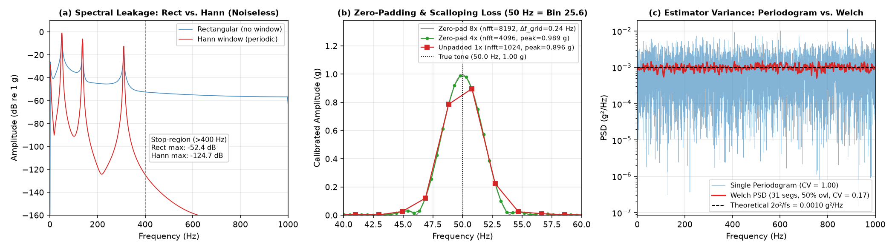

### Key Analytical Takeaways from the 3-Panel Validation Figure

1. **Panel (a) — Non-Integer-Cycle Spectral Leakage (`55.3 Hz`, $28.3136$ cycles in $N=1024$):**
   * Because $55.3\text{ Hz}$ falls between DFT bins $k=28$ ($54.69\text{ Hz}$) and $k=29$ ($56.64\text{ Hz}$), the **Rectangular window** suffers severe $-6\text{ dB/oct}$ sidelobe leakage, holding the high-frequency floor above $400\text{ Hz}$ at **$-52.4\text{ dB}$**.
   * Applying the **periodic Hann window** suppresses the far-out leakage floor above $400\text{ Hz}$ to **$-124.7\text{ dB}$**—an improvement of **$72.3\text{ dB}$** ($>4,000\times$ lower amplitude leakage).
2. **Panel (b) — Zero-Padding & Scalloping Loss Recovery (`50.0 Hz`, bin $25.6$ at $N=1024$):**
   * A pure $1.000\text{ g}$ tone at $50.0\text{ Hz}$ lands $0.4\text{ bins}$ away from bin $k=26$ ($50.78\text{ Hz}$) when $n_{\text{fft}} = N = 1024$. Due to **picket-fence scalloping loss**, the unpadded (`1×`) FFT reads only **$0.896\text{ g}$** ($-0.95\text{ dB}$ error) at $50.78\text{ Hz}$.
   * Zero-padding to $4\times$ ($n_{\text{fft}} = 4096$, $\Delta f_{\text{grid}} = 0.488\text{ Hz}$) samples the continuous Discrete-Time Fourier Transform (DTFT) more densely, recovering **$0.989\text{ g}$ at $49.80\text{ Hz}$**—while clearly illustrating that the physical main-lobe width remains fixed at $4 \cdot (f_s/N) = 7.81\text{ Hz}$ (zero-padding interpolates the spectrum but cannot resolve two tones closer than $f_s/N$).
3. **Panel (c) — Periodogram Inconsistency vs. Welch Variance Reduction ($\sigma = 1.0\text{ g}$ AWGN):**
   * For zero-mean white Gaussian noise with $\sigma = 1.0\text{ g}$ at $f_s = 2000\text{ Hz}$, the theoretical one-sided PSD is flat at $P_{\text{theory}} = 2\sigma^2/f_s = 0.0010\text{ g}^2/\text{Hz}$ ($-30.0\text{ dB}$).
   * The single-window periodogram ($N=4096$) fluctuates wildly around $0.0010\text{ g}^2/\text{Hz}$ with coefficient of variation **$\text{CV} = 1.00$**, whereas Welch's method ($31$ overlapping $256$-sample Hann segments) converges tightly onto the theoretical line with **$\text{CV} = 0.17$** ($5.9\times$ lower standard deviation).

---

## 5. Real-Data Spectral Analysis (`Rail-VIVID`)

### 5.1 Linear vs. Decibel Spectrum & the $58.6\text{ Hz}$ Harmonic Comb (`Ch2`)

On real axle-box/broadband vibration (`BtoA_27.5_2`, Channel 2, $N=1024$), comparing the **linear amplitude spectrum** against the **dB spectrum** highlights why both views are required in railway diagnostics:

````carousel
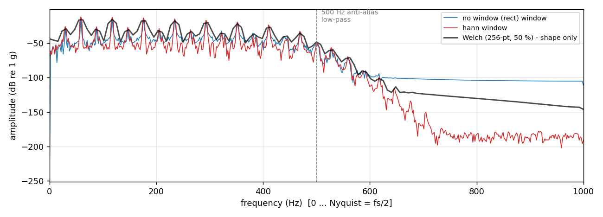
<!-- slide -->
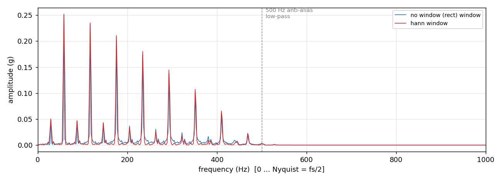
<!-- slide -->
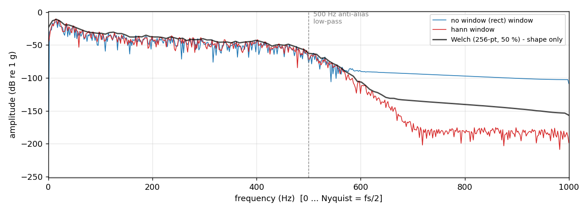
````

* **Harmonic Comb Discovery (`real_ch2_window_vs_rect_linear.png`):** On a linear $\text{g}$ scale, Channel 2 exhibits a textbook harmonic series at integer multiples of the **$f_1 = 58.6\text{ Hz}$** fundamental ($58.6, 117.2, 175.8, 234.4, 293.0, 351.6, 410.2\text{ Hz}$), excited by periodic wheel-rail/gear-mesh excitation at $27.5\text{ km/h}$. However, linear scaling visually flattens everything below $0.02\text{ g}$ into the $x$-axis.
* **Window Leakage in the Passband & Stop-Band (`real_ch2_window_vs_rect_dB.png`):** Switching to a logarithmic dB scale exposes 9 decades of dynamic range ($0\text{ dB}$ down to $-180\text{ dB}$):
  * Between the high harmonics ($300\text{--}480\text{ Hz}$), the Rectangular window's sidelobes from the strong $58.6\text{ Hz}$ and $175.8\text{ Hz}$ peaks artificially elevate the inter-harmonic valley floor to **$-45.4\text{ dB}$**, whereas the **Hann window lowers the valley floor by $8.5\text{ dB}$ to $-53.9\text{ dB}$**, sharpening every harmonic peak.
  * Above the $500\text{ Hz}$ hardware anti-aliasing cutoff, the Rectangular window leaks passband energy across $500\text{--}1000\text{ Hz}$ at **$-100\text{ dB}$**, whereas the Hann window tracks the true stop-band attenuation down to **$-180\text{ dB}$**.
* **When Windowing Does Not Change the Passband Floor (`real_ch1_window_vs_rect_dB.png`):** On Channel 1, real physical broadband track/suspension noise in $100\text{--}450\text{ Hz}$ sits around **$-51\text{ dB}$**, which is higher than the Rectangular sidelobe tail of the $16.6\text{ Hz}$ bogie peak. Thus, in the passband, Hann and Rectangular spectra overlap at $-51.2\text{ dB}$ vs. $-50.9\text{ dB}$; leakage only becomes the dominant floor above $550\text{ Hz}$ where the hardware filter suppresses physical sensor noise.

### 5.2 STFT Spectrogram Overlap Comparison (50% vs. 75%)

Comparing 50% overlap ($H=512$, $\Delta t = 0.256\text{ s}$) against 75% overlap ($H=256$, $\Delta t = 0.128\text{ s}$) on Channel 2 (`BtoA_27.5_2`, $t = 20\text{--}80\text{ s}$) confirms our choice of $H=512$:

| 50% Overlap (`hop = 512`, COLA-Compliant Default) | 75% Overlap (`hop = 256`, $2\times$ Redundant Compute) |
| :---: | :---: |
| 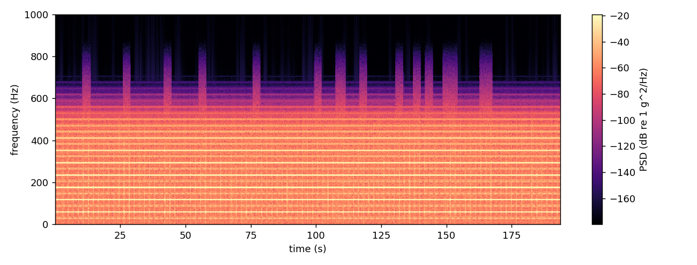 |  |

Both spectrograms clearly resolve the horizontal harmonic bands ($58.6\text{ Hz}, 117.2\text{ Hz}, 175.8\text{ Hz}$), the sharp $500\text{ Hz}$ anti-alias cliff, and brief broadband vertical bursts. While $75\%$ overlap visually interpolates the time axis, it doubles feature-extraction compute and increases serial correlation between adjacent anomaly scores without adding new information.

---

## 6. Spectral Feature Extraction & Anomaly Scoring

### 6.1 Four Interpretable Features per Channel (`railguard/features.py`)

For each $N=1024$ segment and each channel $c \in \{1, \dots, 6\}$, [`features.segment_features`](railguard/features.py) computes a compact 4-element feature vector restricted to the physical passband $f_k \in (0, 500]\text{ Hz}$ ($1 \le k \le 256$):

| Feature Name | Mathematical Definition | Units | Physical & Diagnostic Meaning |
| :--- | :--- | :---: | :--- |
| **`rms`** | $\displaystyle \sqrt{\frac{1}{N}\sum_{n=0}^{N-1} \tilde{x}[n]^2}$ | $\text{g}$ | Overall zero-mean vibration intensity; spikes during high-amplitude impacts or severe corrugation |
| **`dom_freq`** | $\displaystyle \arg\max_{f_k \in (0, 500]} A_k$ | $\text{Hz}$ | Primary resonant/excitation frequency (DC bin $k=0$ excluded); tracks speed-dependent wheel/sleeper tones |
| **`spec_energy`** | $\displaystyle \frac{1}{f_s}\sum_{k=1}^{k_{500}} \frac{c_k\, |X_k|^2}{n_{\text{fft}} \cdot \overline{w^2}}$ | $\text{g}^2\cdot\text{s}$ | Window-power-corrected Parseval energy in $(0, 500]\text{ Hz}$; agrees with time-domain energy within $\sim 1\%$ |
| **`spec_centroid`** | $\displaystyle \frac{\sum_{k=1}^{k_{500}} f_k\, P_k}{\sum_{k=1}^{k_{500}} P_k}$ | $\text{Hz}$ | Center of mass of the passband PSD; **shifts sharply upward** toward $200\text{--}350\text{ Hz}$ during impulsive rail defects |

### 6.2 Data Hygiene: Cruise-Speed Gating & Sensor Dropout Masking

Empirical inspection of all 20 Rail-VIVID runs revealed three critical real-world confounders that naive anomaly detectors mistake for track faults:

1. **Train Acceleration/Braking Transients:** Each run begins and ends with stationary/low-speed ramps. [`features.cruise_mask`](railguard/features.py) computes smoothed GPS ground speed (via equirectangular projection over a $1\text{ s}$ window) and flags a segment as `cruise = True` only when $v(t) \ge 0.90 \times \text{median}(v_{\text{run}})$.
2. **Simultaneous Hardware Sensor Dropouts (`ch_ok_1..4`):** Across multiple runs, Channels 1, 3, and 4 intermittently flatline to quantization noise ($\text{RMS} \approx 3\times 10^{-4}\text{ g}$) while Channel 2 continues recording normally ($3\%$ to $69\%$ of cruise segments depending on the run). A channel is marked healthy (`ch_ok = True`) only if $\text{RMS} \ge 0.005\text{ g}$ in **both** the current segment and its $50\%$-overlapping neighbors, eliminating step-edge artifacts at dropout boundaries.
3. **Collection Session Shift (`2025-04-11` vs. `2025-04-18`):** Runs recorded a week apart exhibit a systematic $\sim 1.5\times$ baseline RMS shift due to sensor remounting/track conditioning.

### 6.3 Session-Matched Marginal Mahalanobis Baseline (`railguard/baseline.py`)

Because RMS and spectral energy are right-skewed positive quantities spanning orders of magnitude, [`baseline.BaselineModel`](railguard/baseline.py) applies a log transformation to all 16 active features ($4\text{ features} \times \text{Ch1..Ch4}$):

$$\mathbf{z} = \ln\!\left(\max(\mathbf{x},\, 10^{-12})\right) \in \mathbb{R}^{16}$$

For each collection session $s \in \{\text{2025-04-11}, \text{2025-04-18}\}$ (plus a `__global__` fallback for arbitrary user uploads), a multivariate Gaussian model $\mathcal{N}(\boldsymbol{\mu}_s, \boldsymbol{\Sigma}_s)$ is fitted on complete-case healthy `TRAIN` cruise segments ($8,753$ segments total) using the **Ledoit-Wolf shrinkage covariance estimator** for guaranteed invertibility and optimal conditioning.

When scoring any segment with healthy channel subset $I \subseteq \{1, 2, 3, 4\}$ ($d = 4|I|$ active dimensions), RailGuard analytically marginalizes the Gaussian distribution to the healthy sub-vector $\mathbf{z}_I$ and sub-covariance $\boldsymbol{\Sigma}_{s; I, I}$:

$$\text{Score}(\mathbf{z}_I) = \sqrt{\frac{1}{d}\left(\mathbf{z}_I - \boldsymbol{\mu}_{s, I}\right)^\top \boldsymbol{\Sigma}_{s; I, I}^{-1} \left(\mathbf{z}_I - \boldsymbol{\mu}_{s, I}\right)}$$

Because the quadratic form of a $d$-dimensional standard normal concentrates around $d$, normalizing by $1/d$ inside the square root makes $\text{Score}(\mathbf{z}_I) \approx 1.0$ invariant to whether $1, 2, 3,$ or all $4$ channels are active.

### 6.4 Leave-One-Run-Out (LORO) Decision Thresholds

Thresholds are calibrated strictly on the 14 `TRAIN` runs using **Leave-One-Run-Out (LORO)** cross-validation (fitting on 13 runs, scoring the held-out 14th run) and taking the median of per-run empirical quantiles:

* **`NORMAL-LIKE` ($\text{Score} < 2.69$):** Within the 97.5th percentile of normal cruise vibration.
* **`REVIEW RECOMMENDED` ($2.69 \le \text{Score} < 5.00$):** Exceeds the LORO 97.5th percentile (`thr_review = 2.685`).
* **`HIGH DEVIATION` ($\text{Score} \ge 5.00$):** Exceeds the LORO 99.5th percentile (`thr_high = 5.003`).

---

## 7. Empirical Evaluation & Semi-Synthetic Impact Detection

### 7.1 Strict Run-Level Data Split & Anti-Leakage Guard

To prevent overlapping-window leakage across adjacent segments, all 20 runs are partitioned at the **whole-run level** in [`railguard/config.py`](railguard/config.py):

* **`TRAIN` (14 runs):** `AtoB_20_1`, `AtoB_20_2`, `AtoB_22.5_1..4`, `BtoA_22.5_1..3`, `BtoA_25_1..2`, `BtoA_27.5_1..2` ($15,610$ cruise segments; $8,753$ complete-case healthy segments).
* **`TEST` (3 runs):** `BtoA_27.5_3`, `AtoB_20_4`, `BtoA_25_3` ($3,139$ cruise segments).
* **`VALIDATION` (3 runs, Holdout Locked):** `AtoB_20_3`, `BtoA_25_4`, `BtoA_22.5_4` — hard-blocked in [`railguard/data.py`](railguard/data.py) by `ValidationAccessError` unless explicitly unlocked.

On the held-out clean `TEST` runs, the false-positive rate (FPR) at the `REVIEW` threshold ($2.69$) is **$1.21\%$ overall** ($1.35\%$ on `BtoA_27.5_3`, $1.69\%$ on `AtoB_20_4`, and $0.89\%$ on `BtoA_25_3`), and **$0.29\%$ overall** at the `HIGH` threshold ($5.00$):

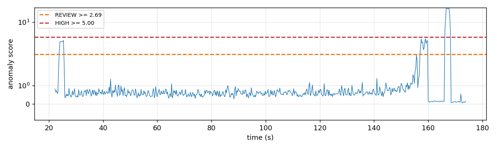

### 7.2 Semi-Synthetic Wheel-Rail Impact Benchmark (`railguard/evaluate.py`)

Because the public dataset has no labeled rail breaks, detection sensitivity is quantified via a physically parameterized **damped sinusoidal impact ring-down** injected into the held-out `TEST` runs (`40` non-overlapping cruise events per run = `115` scorable positive segments across the 3 test runs):

$$e(t) = A \cdot \alpha_c \cdot e^{-t / \tau} \sin(2\pi f_0 t), \qquad 0 \le t \le 100\text{ ms}$$

where $f_0 = 200\text{ Hz}$ models axle-box/rail structural ringing, $\tau = 20\text{ ms}$ is the exponential damping constant, and $\alpha_c$ scales the injection per channel (`1.0` on Ch2/Ch4, `0.5` on Ch1/Ch3). Note that because each $100\text{ ms}$ ring-down has decay constant $\tau = 20\text{ ms}$, its effective energy occupies only $\sim 20\text{ ms}$ ($<4\%$ of a $512\text{ ms}$ segment), making low-amplitude detection a stringent test of spectral centroid and band-energy sensitivity:

| Peak Impact Amplitude $A$ | Threshold Tier | Clean Test FPR | Precision | Recall (Sensitivity) | 95% Wilson CI (Recall) | F1 Score |
| :---: | :---: | :---: | :---: | :---: | :---: | :---: |
| **$0.4\text{ g}$** ($\approx 0.5\times$ Ch2 std) | `REVIEW >= 2.69` | $1.21\%$ | $0.302$ | $0.092$ | $[0.052,\, 0.157]$ | $0.141$ |
| **$0.8\text{ g}$** ($\approx 0.9\times$ Ch2 std) | `REVIEW >= 2.69` | $1.21\%$ | $0.382$ | $0.120$ | $[0.073,\, 0.190]$ | $0.183$ |
| **$1.6\text{ g}$** ($\approx 1.8\times$ Ch2 std) | `REVIEW >= 2.69` | $1.21\%$ | $0.517$ | $0.219$ | $[0.153,\, 0.303]$ | $0.307$ |
| **$3.2\text{ g}$** ($\approx 3.6\times$ Ch2 std) | `REVIEW >= 2.69` | $1.21\%$ | **$0.713$** | **$0.491$** | **$[0.402,\, 0.582]$** | **$0.582$** |
| **$3.2\text{ g}$** ($\approx 3.6\times$ Ch2 std) | `HIGH >= 5.00` | $0.29\%$ | **$0.667$** | $0.097$ | $[0.055,\, 0.165]$ | $0.170$ |

### 7.3 Real-Time Impact Detection Frame (`t = 60.16 s`)

When a $3.2\text{ g}$, $200\text{ Hz}$ damped impact occurs at $t = 60.0\text{ s}$ in `demo_with_injected_events.csv` (`Seg 234`, $t_{\text{mid}} = 60.16\text{ s}$), the instantaneous Hann FFT spectrum clearly captures the broadband $200\text{ Hz}$ resonant hump alongside the natural $58.6\text{ Hz}$ harmonic comb, driving the marginal Mahalanobis score to **$4.69$ (`REVIEW RECOMMENDED`)**:

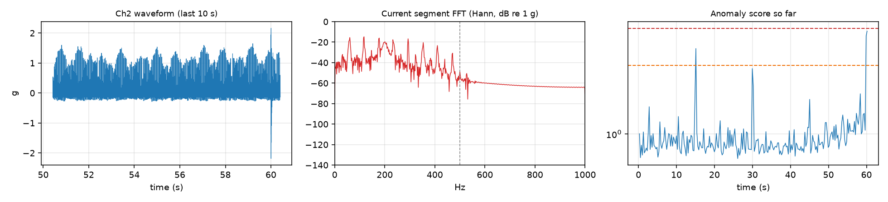

---

## 8. Interactive Streamlit Dashboard & Outputs

The Streamlit application ([`app.py`](app.py)) provides six interactive diagnostic tabs for both real-time streaming replay and deep-dive DSP inspection. Below are actual screenshots captured from the live running application on `demo_with_injected_events.csv`:

### 8.1 Live Streaming Replay Tab (`Live demo`)
Streams the multi-channel CSV in real time ($0.256\text{ s}$ hop per frame), simultaneously updating the $10\text{ s}$ rolling acceleration waveform, the instantaneous calibrated Hann FFT spectrum in dB, and the marginal Mahalanobis anomaly timeline with automatic alert counters:

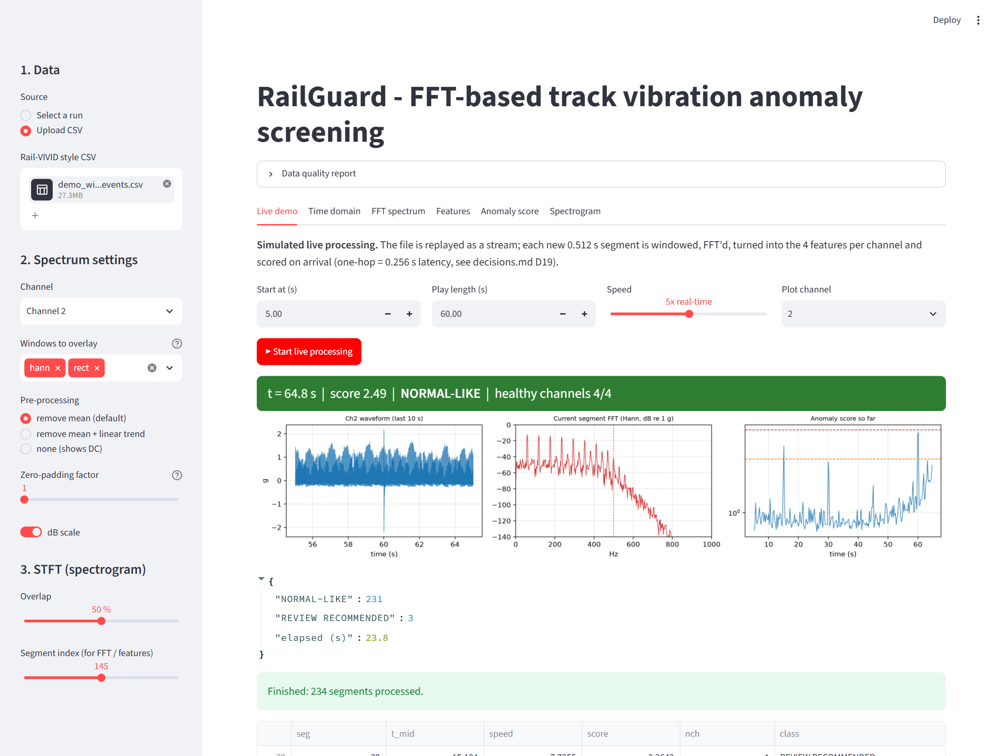

### 8.2 Time-Domain & Automated Data Hygiene Report (`Time domain`)
Displays the full-run waveform with the selected $N=1024$ ($0.512\text{ s}$) analysis window highlighted in orange, accompanied by an automated **Data Quality Report** verifying exact $2000\text{ Hz}$ sampling, timestamp monotonicity, NaN checks, and per-channel active duty cycles:

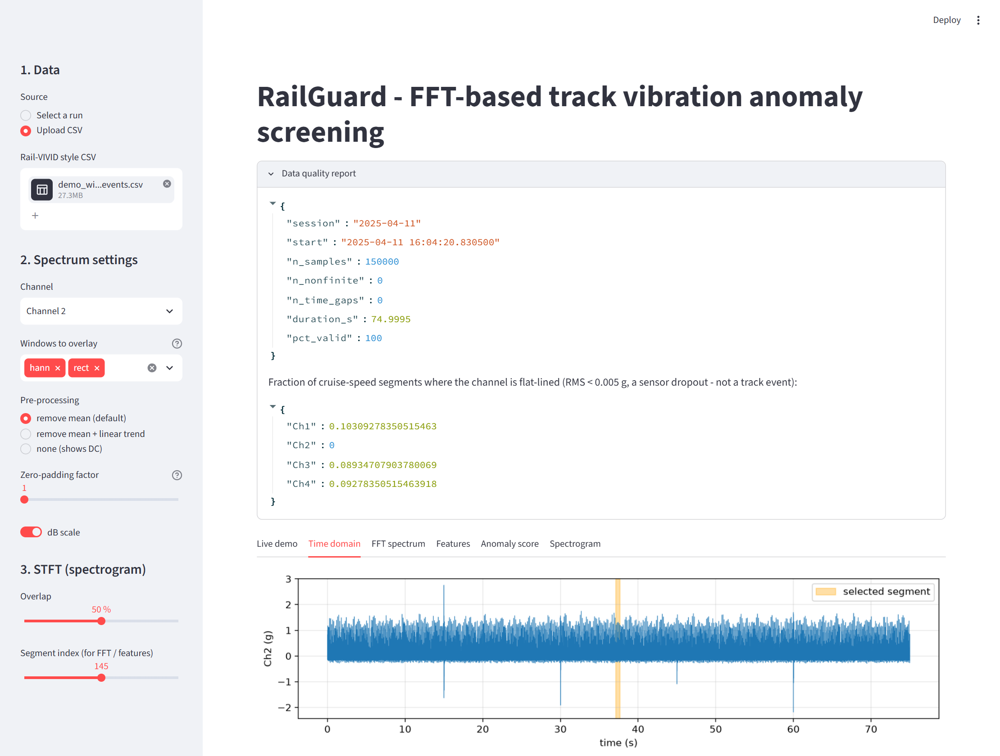

### 8.3 Side-by-Side Calibrated FFT Spectrum & Live Parseval Verification (`FFT spectrum`)
Renders both the **linear one-sided amplitude spectrum ($\text{g}$)** and the **log-scale dB spectrum ($\text{dB re } 1\text{ g}$)** with optional $256$-point Welch overlay, interactive window switching (`hann`, `hamming`, `rect`), zero-padding factor (`1×`, `2×`, `4×`), and a live **Parseval Energy Conservation** readout (`time = 45.4273` vs `freq = 45.4273`):

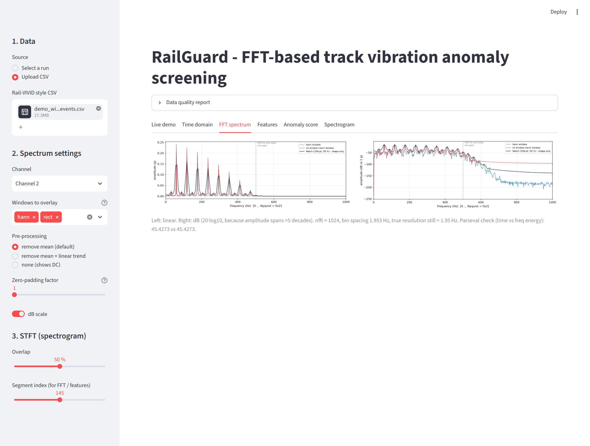

### 8.4 Multi-Channel Spectral Feature Matrix (`Features`)
Inspects the 4 passband features (`rms`, `dom_freq`, `spec_energy`, `spec_centroid`) across all 6 channels for any selected segment, alongside the complete segment-by-segment feature table:

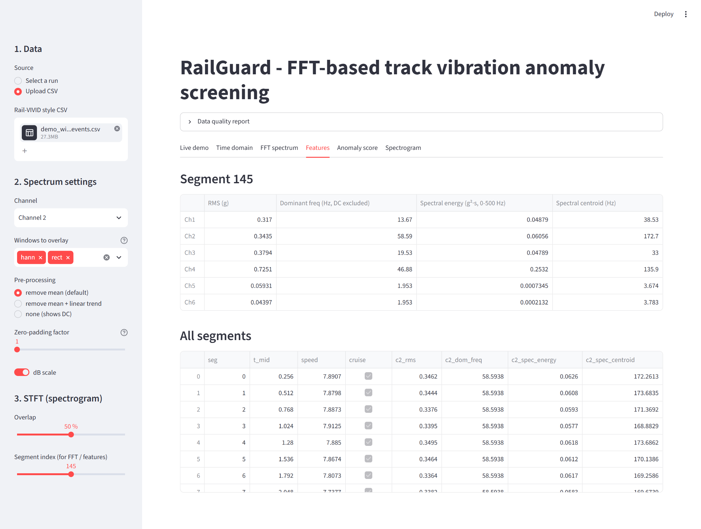

### 8.5 Anomaly Score Timeline & Flagged Segment Table (`Anomaly score`)
Plots the session-matched Ledoit-Wolf Mahalanobis score across the entire run against the LORO thresholds (`REVIEW = 2.69`, `HIGH = 5.00`) and lists every flagged segment with its exact timestamp, GPS speed, active channel count, and per-channel spectral features:

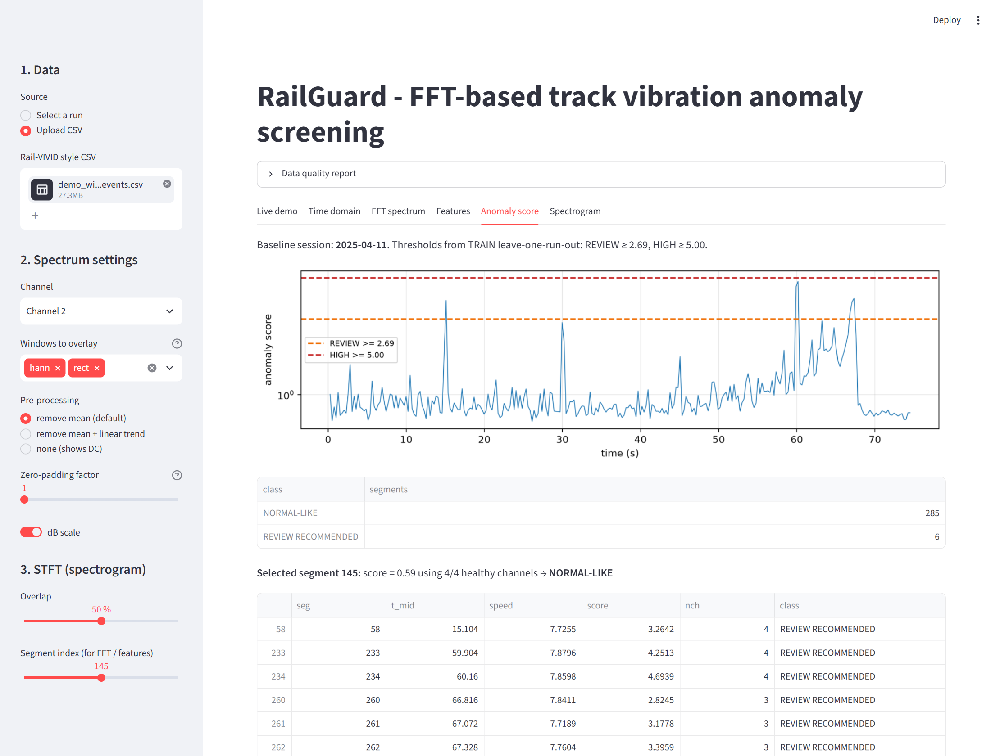

### 8.6 Whole-Run STFT Spectrogram (`Spectrogram`)
Displays the $N=1024$ Hann-windowed STFT Power Spectral Density heatmap ($0\text{--}1000\text{ Hz}$). Note how the **4 injected wheel-rail impacts at $t = 15, 30, 45, 60\text{ s}$** stand out unmistakably as vertical broadband orange/yellow stripes extending into the $200\text{--}500\text{ Hz}$ passband, while the $500\text{ Hz}$ Butterworth low-pass cutoff forms a dark horizontal boundary across the entire run:

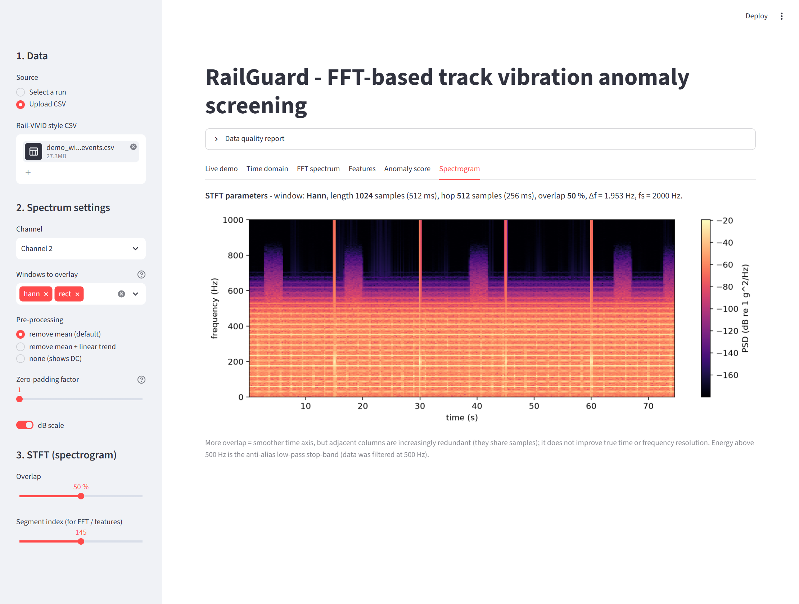

---

## 9. Synthetic DSP & FFT Unit Test Suite

RailGuard includes a rigorous 16-test verification suite in [`tests/test_dsp_synthetic.py`](tests/test_dsp_synthetic.py) and [`tests/test_pipeline.py`](tests/test_pipeline.py) that mathematically locks every DSP equation and pipeline invariant:

| Test File | Test Function | Verified Mathematical / Engineering Property |
| :--- | :--- | :--- |
| `test_dsp_synthetic.py` | `test_single_tone_bin_centered` | Bin-centered $62.5\text{ Hz}$ ($k=32$) $1.5\text{ g}$ sine recovers exact frequency ($<10^{-9}\text{ Hz}$ error) and amplitude within $0.1\%$ |
| `test_dsp_synthetic.py` | `test_two_tone_resolution` | Resolves $50\text{ Hz}$ ($1.0\text{ g}$) and $180\text{ Hz}$ ($0.4\text{ g}$) simultaneously within $1.5\%$ amplitude accuracy |
| `test_dsp_synthetic.py` | `test_dc_offset_removal` | A $+5.0\text{ g}$ static DC offset is completely removed by `preprocess` ($A_0 < 10^{-12}\text{ g}$), leaving a $40\text{ Hz}$ tone intact |
| `test_dsp_synthetic.py` | `test_leakage_hann_beats_rect_far_from_tone` | On non-integer-cycle $55.3\text{ Hz}$, Hann window suppresses $>400\text{ Hz}$ sidelobe leakage by $>40\text{ dB}$ vs. Rectangular |
| `test_dsp_synthetic.py` | `test_zero_padding_interpolates_off_bin_peak` | $4\times$ zero-padding ($n_{\text{fft}}=4096$) eliminates scalloping loss on off-bin $50.0\text{ Hz}$ ($0.989\text{ g}$ vs. $0.896\text{ g}$ at $1\times$) |
| `test_dsp_synthetic.py` | `test_welch_variance_lower_than_periodogram_on_white_noise` | On AWGN ($\sigma=1\text{ g}$), Welch PSD achieves $\text{CV} < 0.30$ vs. Periodogram $\text{CV} > 0.85$ and matches $2\sigma^2/f_s$ within $15\%$ |
| `test_dsp_synthetic.py` | `test_parseval_holds_for_all_windows` | Time-domain and one-sided DFT energies match to $<10^{-10}$ relative error across `rect`, `hann`, and `hamming` |
| `test_dsp_synthetic.py` | `test_spectral_energy_matches_time_domain_energy` | Window-power-corrected `spec_energy` matches $\frac{1}{f_s}\sum \tilde{x}^2$ within $2\%$ |
| `test_dsp_synthetic.py` | `test_spectral_centroid_shifts_with_high_freq_content` | Adding a $200\text{ Hz}$ component to a $30\text{ Hz}$ base signal shifts `spec_centroid` upward by $>50\text{ Hz}$ |
| `test_dsp_synthetic.py` | `test_dominant_frequency_never_returns_dc` | Even without detrending under a $+10\text{ g}$ DC bias, `segment_features` strictly excludes bin $k=0$ from `dom_freq` |
| `test_pipeline.py` | `test_validation_guard_blocks_by_default` | Calling `load_run("AtoB_20_3")` raises `ValidationAccessError` to protect holdout integrity |
| `test_pipeline.py` | `test_split_counts_and_disjointness` | Verifies 14 TRAIN / 3 TEST / 3 VALIDATION runs are mutually disjoint ($20$ total) |
| `test_pipeline.py` | `test_dead_channel_detection` | Confirms `DEAD_RMS = 0.005 g` masks flatlined $10^{-4}\text{ g}$ channels while preserving active channels |
| `test_pipeline.py` | `test_baseline_marginal_scoring_handles_partial_channels` | Verifies marginal Mahalanobis scoring returns $\approx 1.0$ on normal segments even when Ch1/Ch3/Ch4 drop out |
| `test_pipeline.py` | `test_Baseline_flags_injected_impact` | Confirms a $+5\text{ log-unit}$ impact shift raises the anomaly score above `thr_high = 5.00` (`HIGH DEVIATION`) |

---

## 10. Repository Structure & Quickstart

```text
Railguard_dspcie/
├── app.py                        # 6-tab Streamlit dashboard (Live replay, Time, FFT, Features, Score, Spectrogram)
├── run_pipeline.py               # End-to-end CLI pipeline: feature extraction, baseline fit, LORO, evaluation, figures
├── requirements.txt              # Python dependencies (numpy, scipy, pandas, matplotlib, scikit-learn, streamlit, pytest)
├── decisions.md                  # Chronological engineering decision log (D01–D18) with quantitative justifications
├── system_architecture.md        # Detailed mathematical architecture, data hygiene, and anti-leakage specification
├── railguard/
│   ├── config.py                 # Locked DSP constants (FS=2000, SEG_LEN=1024, HOP=512, FMAX=500) & run splits
│   ├── data.py                   # CSV ingestion, GPS speed calculation, data quality report, and holdout split guard
│   ├── dsp.py                    # Core FFT/DSP module: preprocess, windows, rfft amplitude_spectrum, PSD, STFT, Parseval
│   ├── features.py               # 50%-overlapping segmentation, cruise/dropout masks, and 4 passband spectral features
│   ├── baseline.py               # Per-session log-space Ledoit-Wolf Gaussian baseline & marginal Mahalanobis scorer
│   ├── evaluate.py               # Clean test FPR and semi-synthetic damped-impact injection benchmark
│   └── plots.py                  # Publication-grade Matplotlib visualizations for CLI and Streamlit UI
├── demo_data/
│   ├── demo_clean.csv            # 90 s unmodified excerpt of held-out test run BtoA_25_3 (180,000 rows @ 2000 Hz)
│   └── demo_with_injected_events.csv # Same 90 s run with 4 damped 200 Hz wheel-rail impacts at t = 15, 30, 45, 60 s
├── outputs/
│   ├── baseline_model.pkl        # Fitted per-session Ledoit-Wolf baseline & LORO thresholds (REVIEW=2.69, HIGH=5.00)
│   ├── results.json              # Complete evaluation metrics, LORO thresholds, and Wilson 95% confidence intervals
│   └── figures/                  # All generated DSP diagnostic plots and UI screenshots embedded in this README
└── tests/
    ├── test_dsp_synthetic.py     # 10 analytical unit tests for FFT calibration, leakage, zero-padding, Welch, Parseval
    └── test_pipeline.py          # 6 integration tests for holdout guards, dropout masking, and marginal scoring
```

### Quickstart Instructions

#### 1. Create Environment & Install Dependencies
```powershell
python -m venv .venv
.\.venv\Scripts\pip install -r requirements.txt
```

#### 2. Run the Synthetic DSP & Pipeline Unit Tests
```powershell
.\.venv\Scripts\python -m pytest -v -s tests
```

#### 3. Launch the Interactive Streamlit Dashboard
```powershell
.\.venv\Scripts\python -m streamlit run app.py
```
* Open `http://localhost:8501` in your browser.
* Use **Select a run** (`BtoA_25_3`) or switch to **Upload CSV** and upload `demo_data/demo_with_injected_events.csv` to watch the **Live demo** tab detect the injected $200\text{ Hz}$ rail-joint impacts in real time.

#### 4. Re-Run the Full Offline Pipeline (Optional — Requires Full `Rail-VIVID` Dataset in `data/raw/runs/`)
```powershell
.\.venv\Scripts\python run_pipeline.py
```
