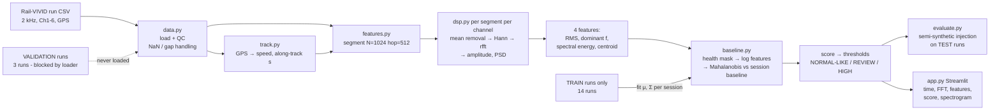

# RailGuard – System Architecture (snapshot of the final system)

*decisions.md is the chronological "why"; this file is the "what is there now".*
Section numbers are referenced from the code and the app.

## 1. Pipeline overview



## 2. Files and responsibilities

| File | Responsibility |
|---|---|
| `railguard/config.py` | All parameters (fs, N, hop, window, 500 Hz band, channels, features) and the run split (TRAIN / TEST / VALIDATION lists, seed 42). |
| `railguard/dsp.py` | **The DSP core**: preprocessing (mean/linear detrend), periodic window, `rfft` frequency axis, calibrated one-sided amplitude spectrum, dB conversion, periodogram PSD, Welch PSD, Parseval check, the four features. Every function is unit-tested on synthetic signals. |
| `railguard/data.py` | CSV loading and QC (schema normalisation, non-finite values, timestamp gaps), `load_run` with the **validation-split guard**. |
| `railguard/track.py` | Local metric projection of GPS, reference polyline, along-track coordinate `s`, GPS speed. |
| `railguard/features.py` | Segmentation (drops segments containing invalid samples), cruise-speed flag, per-channel features → one row per segment. |
| `railguard/baseline.py` | Channel-health masking, log-feature matrix, per-session Gaussian baseline (Ledoit-Wolf), Mahalanobis score with marginalisation over dead channels, leave-one-run-out scoring, classification. |
| `railguard/evaluate.py` | Event injection, segment labelling, precision/recall/F1/FPR, Wilson intervals. |
| `railguard/plots.py` | Matplotlib figure builders shared by app and scripts. |
| `scripts/download_data.py` | Downloads the 20 run CSVs (~1.9 GB), size-verified. |
| `scripts/extract_features.py` | Features for TRAIN+TEST → `outputs/features.csv.gz`, `outputs/track_ref.npz`. |
| `scripts/fit_and_evaluate.py` | Fits baseline, picks thresholds, saves `outputs/model.pkl`, runs injection evaluation → `outputs/results.json`, `outputs/threshold_sweep.csv`. |
| `scripts/make_figures.py` | Documentation figures → `outputs/figures/`. |
| `app.py` | Streamlit interface. |
| `tests/test_dsp_synthetic.py`, `tests/test_pipeline.py` | 16 tests (10 FFT-vs-synthetic-truth, 6 pipeline/guard). |
| `decisions.md` | Decision log. |

## 3. The FFT / DSP chain (per segment, per channel)

Notation: `fs = 2000 Hz`, segment `x[n]`, `n = 0…N-1`, `N = 1024` (0.512 s).

1. **Mean removal** `x ← x − mean(x)`. Removes the DC term (gravity projection / sensor offset). Without it the k=0 line and its window skirt contaminate the lowest bins. *Linear detrend* additionally removes a slope (`x ← x − (a + b n)`); it is available as an option but off by default: over 0.5 s the drift is negligible compared to the vibration and the window already suppresses end-point effects. (A synthetic ramp of 0.3 g/s is removed by the `linear` option; test `test_mean_removal_kills_dc_and_detrend_kills_ramp`.)
2. **Window** `y[n] = w[n]·x[n]`, Hann, *periodic* form: `w[n] = 0.5(1 − cos(2πn/N))`. A finite segment is the product of the signal with a rectangular window, which convolves the spectrum with a sinc (sidelobes −13 dB, decaying 6 dB/oct) → *leakage*: strong low-frequency energy spills over weak high-frequency bins. Hann sidelobes start at −31 dB and decay 18 dB/oct. Costs: main lobe 2× wider (4 bins null-to-null), scalloping loss ≤ 1.42 dB for off-bin tones, and amplitude scaling (`Σw = N/2`).
3. **FFT** `Y[k] = Σ y[n] e^{−j2πkn/N}`, computed with `np.fft.rfft` (input is real ⇒ `Y[N−k] = Y*[k]`; the negative half carries no extra information).
4. **Frequency axis** `f_k = k·fs/N`, `k = 0…N/2` → 0 … 1000 Hz (Nyquist `fs/2`). Resolution `Δf = fs/N = 1.953 Hz`. No zero-padding in the feature pipeline (`nfft = N`).
5. **Amplitude normalisation** `A_k = 2|Y_k|/Σw` for `0<k<N/2`; DC and Nyquist bins are not doubled. For a rectangular window `Σw = N` (the textbook "divide by N"); for Hann `Σw = N/2`, so dividing by N would under-read by 6 dB. The factor 2 restores the energy of the discarded negative frequencies. A sine of amplitude *a* reads *a* (within Hann scalloping).
6. **dB**: `20·log10(A_k / 1 g)`. Amplitude (not power) → 20. Used because vibration spectra span many decades (in this data 100 dB between 100 Hz and the stop-band) and ratios are what matter.
7. **PSD** (g²/Hz): periodogram `|Y_k|²/(fs·Σw²)` (×2 one-sided) for a single segment, and **Welch** (`scipy.signal.welch`, 256-sample Hann sub-segments, 50 % overlap) for stable estimates. The raw periodogram has ~100 % relative standard deviation per bin regardless of N (measured coefficient of variation 1.00); Welch averaging with 16 segments gave 0.17, at the price of coarser resolution (`fs/256 = 7.8 Hz`). Use the single-segment FFT when you need fine frequency resolution of one event (peak finding, features); use Welch for a stable *shape* of a longer stationary stretch (the run-level PSD in `welch_psd_500Hz_lowpass.png`, the app overlay).
8. **Resolution vs time-localisation trade-off.** `Δf = 1/T`: halving T doubles Δf but halves the position localisation (and vice versa). `N = 512` (0.256 s, Δf 3.9 Hz, Hann lobe 15.6 Hz wide) would merge lines closer than ~16 Hz (peaks ~8 Hz apart occur, e.g. Ch4 50.8 vs Ch2 58.6 Hz); `N = 2048` (1.02 s, Δf 0.98 Hz) would average a short defect with ≈ 6–8 m of normal track. `N = 1024` covers ≈ 3–4 m of track at 20–30 km/h with 1.95 Hz resolution. Zero-padding to 4N gives a spectrum sampled every 0.49 Hz but the same main-lobe width: peak reading of a 50 Hz tone moved 50.78 Hz/0.896 g → 49.80 Hz/0.989 g (interpolation), no new resolution.
9. **Features** (computed on the mean-removed segment, band 0 < f ≤ 500 Hz because the data is hardware-filtered at 500 Hz):

| Feature | Formula | Physical meaning |
|---|---|---|
| RMS | `sqrt(mean(x²))` (time domain, after mean removal) | overall vibration intensity (g); responds to roughness, speed, defects |
| Dominant frequency | `f_k` of `argmax_{k≥1} A_k` — **DC bin (k=0) excluded** | strongest periodic component (e.g. 58.6 Hz harmonic family); DC/near-DC is offset or drift, not a vibration frequency |
| Spectral energy | `Σ_{k=1..500Hz} c_k|Y_k|² / (N·mean(w²)) / fs` (g²·s), `c_k = 2` for mirrored bins | energy in the band; by Parseval ≈ `Σx²/fs`. Sanity check on the FFT itself (synthetic: 0.3345 vs 0.3381 g²·s, 1 %) |
| Spectral centroid | `Σ f_k P_k / Σ P_k` over `k≥1`, `P` = power | "centre of mass" of the spectrum; shifts up when high-frequency/impulsive content grows |

   **Parseval's relation:** `Σ|y[n]|² = (1/N) Σ_{k=0}^{N−1}|Y[k]|²`. `dsp.parseval_check` evaluates the right side from the one-sided `rfft` by weighting mirrored bins ×2 and agrees with the time-domain sum to 1e-10 relative for rect/Hann/Hamming (unit test). The window-power-corrected `spec_energy` feature is approximate by design.

## 4. Segmentation and STFT parameters

* Segment/STFT window: **1024 samples = 0.512 s, Hann**; hop **512 samples (0.256 s) = 50 % overlap**.
* Why 50 %: Hann at 50 % overlap satisfies COLA (the overlapped windows sum to a constant), so no part of the signal is systematically down-weighted, and a defect near a segment edge is seen at the centre of the neighbouring segment. More overlap (75 %, selectable in the spectrogram) only makes the picture smoother: neighbouring columns share samples, so they are *not independent measurements* and resolution is unchanged.
* Along-track length: speed 5.4–9.9 m/s ⇒ 2.8–5.1 m per segment, hop 1.4–2.5 m.
* Invalid-sample-containing segments are dropped. A segment is "cruise" if its GPS speed ≥ 90 % of the run median (D11).

## 5. Train / test / validation logic

* Unit of splitting: **run** (consecutive 50 %-overlapping segments of one run are near-duplicates; segment-level splits would leak).
* 20 runs → 14 train / 3 test / 3 validation (70/15/15), seed 42, stratified by (direction, nominal speed) using run names only; list in `config.py` and decisions.md D06.
* TRAIN → fits baselines (μ, Σ) and the threshold rule; TEST → reported metrics (and an optional threshold sweep); VALIDATION → belongs to you. `data.load_run` raises `ValidationAccessError` for those 3 runs; the app does not list them.
* Known weakness: split stratified on nominal speed while the collection **day** is the real nuisance factor (decisions D06/D13).

## 6. Anomaly scoring and classification

1. Health mask per channel (Ch1-4): unhealthy if segment RMS < 0.005 g or a same-run neighbour's is.
2. Feature vector: `x = [ln RMS, ln E, ln centroid, ln f_dom]` for each healthy channel (up to 16 numbers).
3. Per-session baseline fitted on TRAIN, cruise, all-4-channels-healthy segments: `μ`, `Σ` (Ledoit-Wolf shrinkage).
4. Score `s = sqrt( (x−μ)ᵀ Σ⁻¹ (x−μ) / d )` using the sub-vector/sub-block of the healthy channels (`d` = their number of features). ≈ 1 for typical segments.
5. Thresholds from TRAIN leave-one-run-out scores: REVIEW = median over runs of the per-run 97.5th percentile (**2.69**), HIGH = median of per-run 99.5th percentile (**5.00**).
6. Class: `score ≥ 5.00` → **HIGH DEVIATION**; `≥ 2.69` → **REVIEW RECOMMENDED**; else **NORMAL-LIKE**; non-cruise or no healthy channel → N/A.
7. Interpretation: "unlike this day's normal behaviour" – a triage flag, not a diagnosis. Sensor/vehicle effects (D12/D13) and real track features are not distinguished.

## 7. Streamlit interface ↔ backend

| UI element | Backend |
|---|---|
| Select run / upload CSV | `data.load_run` (blocks validation) / `data.load_csv`; cached `process()` → `features.extract_run_features` |
| Data quality expander | `qc` dict from the loader + dropout fraction via `baseline.DEAD_RMS` |
| Time-domain tab | `plots.time_domain`, selected segment highlighted (index slider) |
| FFT tab: linear + dB, windows overlay (Hann / Hamming / rect), pre-processing (mean / +linear / none), zero-padding factor | `dsp.amplitude_spectrum` (+ Welch overlay, `dsp.parseval_check` caption) |
| Features tab | segment table (6 channels × 4 features) + all-segment table from `features.py` |
| Anomaly score tab | `Baseline.score` + `classify` with thresholds from `outputs/model.pkl`; timeline `plots.score_timeline`; list of flagged segments; healthy-channel count |
| Spectrogram tab | `scipy.signal.spectrogram`; STFT parameters printed (window, length, hop, overlap %, Δf) |

## 8. Results at a glance (details in decisions.md D16)

Semi-synthetic injection on the 3 TEST runs, REVIEW threshold 2.69, FPR 1.2 %: recall 9 % / 12 % / 22 % / 49 % for 0.4 / 0.8 / 1.6 / 3.2 g events (precision 0.30 → 0.71). There is **no real-anomaly precision/recall** because Rail-VIVID provides no machine-readable anomaly locations (D03/D14).

## 9. Extending with real anomaly locations

If you obtain GPS/along-track positions for the anomalies: convert each to along-track metres `s` via `TrackReference.project` (reference in `outputs/track_ref.npz`; xy and s arrays), then label test segments whose `s ± tolerance (≈ 10 m: GPS error + 3-5 m segment)` covers an anomaly as positives and call `evaluate.prf` on `score ≥ threshold`. This is *not implemented in the scripts*; `features.csv.gz` already contains `s` for every train/test segment.

## 10. Running everything end to end

```bash
python -m venv .venv && .venv\Scripts\activate        # Windows (Linux/macOS: source .venv/bin/activate)
pip install -r requirements.txt
pytest -s tests                                       # FFT validated against synthetic truth first
python scripts/download_data.py                       # ~1.9 GB, resumable by size check
python scripts/extract_features.py                    # train+test only
python scripts/fit_and_evaluate.py                    # model.pkl, thresholds, injection metrics
python scripts/make_figures.py                        # optional documentation figures
streamlit run app.py
```
